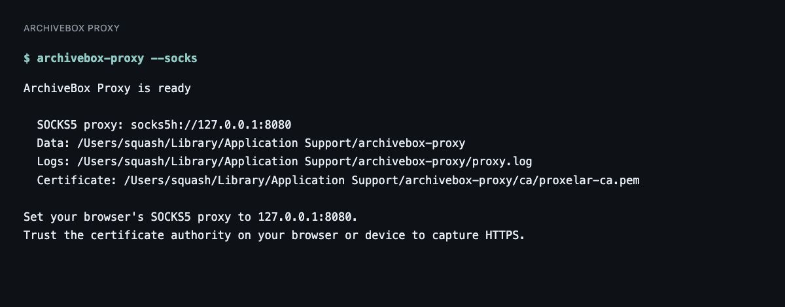

<div align="center">


# ArchiveBox Proxy

<p><strong>Browse once. Archive in the background. Replay from your collection.</strong></p>
<p>HTTPS caching · Automatic captures · HTTP/3 · Archive replay</p>
<p>
  <a href="#installation">Get started</a> ·
  <a href="#configuring-an-https-client">Connect a browser</a> ·
  <a href="#modes">CLI &amp; configuration</a> ·
  <a href="#capture--replay">Capture &amp; replay</a>
</p>

[](https://github.com/ArchiveBox/archivebox-proxy/actions/workflows/test.yml)
[](https://github.com/ArchiveBox/archivebox-proxy/blob/master/LICENSE)

</div>

<table>
<tr>
<th width="42%">① Your browser</th>
<th width="16%">② Proxy</th>
<th width="42%">③ ArchiveBox</th>
</tr>
<tr>
<td valign="middle"><a href="https://raw.githubusercontent.com/ArchiveBox/archivebox-proxy/master/docs/images/visitor-likes.png"></a></td>
<td align="center" valign="middle">
<strong>→ Cache</strong><br><br>
<strong>Hook →</strong><br><br>
<strong>← Capture requests</strong><br>
<sub>Reuse cache</sub>
</td>
<td valign="middle"><a href="https://raw.githubusercontent.com/ArchiveBox/archivebox-proxy/master/docs/images/archivebox-likes.png"></a></td>
</tr>
<tr>
<td align="center"><sub>Browse and scroll to populate the cache.</sub></td>
<td align="center"><sub>Cache → archive → upstream</sub></td>
<td align="center"><sub>ArchiveBox runs its normal capture and saves the snapshot.</sub></td>
</tr>
</table>

<p align="center"><sub>The navigation hook runs <code>archivebox add --depth=0 URL</code>. ArchiveBox captures through the same cache and saves a snapshot ready to replay.</sub></p>

- 🌐 **Browse normally.** Your visits populate the HTTP/HTTPS response cache.
- 📸 **Archive automatically.** Top-level navigations trigger normal [ArchiveBox](https://github.com/ArchiveBox/ArchiveBox) captures, with your plugins and authentication persona.
- ⚡ **Reuse what you already downloaded.** ArchiveBox reads through the same cache; additional resources go upstream through the same proxy.
- ⏪ **Replay from your collection.** Saved `responses/` files and `archivewebpage/*.wacz` can satisfy cache misses before another internet request.

Your browser and ArchiveBox use the same proxy cache. ArchiveBox saves snapshots through its normal capture pipeline, and the proxy can replay those saved responses later. Each user runs their own proxy and collection.

## Installation

**Linux & macOS · ARM64 & AMD64 · Python 3.11+**

Install with [uv](https://docs.astral.sh/uv/getting-started/installation/), then start the proxy:

```bash
uv tool install archivebox-proxy
archivebox-proxy --socks
```

Already using a Python environment? Install with `uv pip install archivebox-proxy` or `pip install archivebox-proxy` instead.

The proxy creates its cache and certificate automatically. Follow the connection details printed at startup to [connect your browser](#configuring-an-https-client).



**Archive pages as you browse** by selecting your existing [ArchiveBox collection](https://github.com/ArchiveBox/ArchiveBox#quickstart):

```bash
archivebox-proxy --socks --archivebox ~/archivebox
```

For authenticated pages, add `--persona "Socials Only"` to use the same saved session as your browser. Captures reuse the proxy cache, and saved snapshots become available for replay.

<details>
<summary><strong>Docker Compose</strong></summary>

Download this repository and start the proxy with `docker compose up -d --build`.

To include ArchiveBox, set `ARCHIVEBOX_DATA` to your initialized collection and use the [capture configuration](https://github.com/ArchiveBox/archivebox-proxy/blob/master/compose.capture.yaml). It uses **`archivebox/archivebox:dev`**. The [archive configuration](https://github.com/ArchiveBox/archivebox-proxy/blob/master/compose.archive.yaml) mounts an existing collection for replay.

</details>

## Configuring an HTTPS Client

1. **Connect.** Set your browser's SOCKS5 proxy to `127.0.0.1:8080`. For browsers using an HTTP/HTTPS proxy, start with `--http` instead.
2. **Trust the certificate.** Import the CA certificate shown at startup into your browser or device's trusted certificate authorities. Do this once per device.
3. **Browse.** Visits fill the cache; with `--archivebox`, new page navigations also queue ArchiveBox snapshots.

| Connect using | Setup |
| --- | --- |
| HTTP/HTTPS | Start with `--http`; set both browser proxy fields to `127.0.0.1:8080` |
| SOCKS5 | Start with `--socks`; use `127.0.0.1:8080` and enable proxy DNS in your browser |
| WireGuard | Start with `--wireguard`; import the generated configuration shown at startup into [WireGuard](https://www.wireguard.com/install/) |

For another device or a Wi-Fi hotspot, use `--bind 0.0.0.0` and connect to this computer's IP address. With WireGuard, also set `--wireguard-endpoint HOST:PORT` to the address clients can reach.

ArchiveBox's capture tools receive their proxy and certificate settings automatically.

## Modes

One command selects how clients connect:

| Command | Transport |
| --- | --- |
| `archivebox-proxy --http` | HTTP/HTTPS proxy; default |
| `archivebox-proxy --socks` | SOCKS5 |
| `archivebox-proxy --wireguard` | WireGuard tunnel |
| `archivebox-proxy --reverse --target https://your-site.com` | Reverse proxy |
| `archivebox-proxy --dns` | DNS proxy |
| `archivebox-proxy --udp --target HOST:PORT` | UDP forwarding |

HTTP/3 capture and replay are available in reverse mode with an `http3://` target. WebSocket connections and other long-lived streams are forwarded and logged.

**Recording, caching, and archive replay are independent:**

| Setting | CLI | Environment |
| --- | --- | --- |
| Automatic navigation recording and capture hooks | `--record` / `--no-record` | `PROXY_RECORD=true` / `false` |
| Proxy response cache | `--cache` / `--no-cache` | `PROXY_CACHE=true` / `false` |
| Replay from the ArchiveBox collection | `--replay` / `--no-replay` | `PROXY_REPLAY=true` / `false` |

All three are enabled by default. Select a collection with `--archivebox PATH` for capture and replay, or `--archive PATH` for replay only.

<details>
<summary><strong>Cache settings and advanced options</strong></summary>

| Option | Default |
| --- | --- |
| `--policy auto` | Fresh cache → ArchiveBox archive → upstream |
| `--policy record` | Upstream; replace matching cache entries |
| `--policy replay` | Cache, including expired entries → archive → upstream |
| `--policy offline` | Cache, including expired entries → archive → HTTP 504 on a miss |
| `--cache-gb 50` | 50 GiB disk budget, least-recently-used eviction |
| `--body-limit 67108864` | 64 MiB per request or response body |
| `--data PATH` | Your user's application data directory |
| `--port 8080` | Browser listener |
| `--worker-port 8082` | Capture listener |

Responses stay fresh for **at least 24 hours**; longer origin freshness is retained. The cache includes completed POST responses and HTTP errors. Matches use the method, exact URL, request body, Range, Accept-Encoding, and Content-Type. Cookies do not partition the single-user cache. `no-store` does not prevent caching.

`offline` controls intercepted HTTP requests. DNS and raw UDP retain their transport behavior.

Options also accept `PROXY_` environment variables: `--data` → `PROXY_DATA`, `--port` → `PROXY_PORT`, and `--archivebox-dir` → `PROXY_ARCHIVEBOX_DIR`. CLI flags take precedence. Run `archivebox-proxy --help` for all options.

Custom navigation hooks use `--hook` with a JSON argument array. `{url}` is substituted literally; repeat `--hook` to run multiple commands. The built-in ArchiveBox hook handles the normal `archivebox add --depth=0` workflow.

</details>

## Capture & replay

**The screenshots above show a real authenticated capture.** Chrome visited X Likes and scrolled four pages using the **Socials Only** persona. The navigation hook started ArchiveBox with the same persona, and the resulting snapshot preserved the signed-in page and post images.

| Measured during that capture | Result |
| --- | --- |
| Worker GETs for URLs already fetched by the browser | **388 cache hits, 0 misses** |
| Post images from `pbs.twimg.com` | **287 cache hits, 0 misses** |
| Page document and Likes API request | Fetched once, then reused from cache |
| All worker requests, including new resources | **405 / 604 cache hits (67.1%)** |

<details>
<summary><strong>View the proxy logs and capture details</strong></summary>

[](https://raw.githubusercontent.com/ArchiveBox/archivebox-proxy/master/docs/images/proxy-logs.png)

ArchiveBox also requested 156 resources the visitor had not populated and made 43 POST requests that missed the cache. POST matching includes the request body; the WACZ retained 41 requests to that endpoint with 41 distinct body hashes.

Top-level navigations are recorded in `navigations.jsonl`. Hooks start after ten seconds to let the browser populate the cache, and successful captures are deduplicated by URL for 24 hours. `hooks.jsonl` records hook outcomes; `hooks.log` contains capture output. The capture listener avoids recursively queuing another capture.

Archive replay reads existing `responses/` files and `archivewebpage/*.wacz` through their CDX/CDXJ indexes. The proxy keeps its cache and derived index separately from the ArchiveBox collection.

</details>

### History

2024-01: [Bruno Schroeder (@brunocek)](https://github.com/brunocek/archivebox-proxy) contributed the original mitmproxy navigation recorder.

2026-11: Rewritten around [Proxelar](https://github.com/emanuele-em/proxelar), an independent response cache, asynchronous navigation hooks, and read-only ArchiveBox replay.

[MIT](https://github.com/ArchiveBox/archivebox-proxy/blob/master/LICENSE). Proxelar retains its [MIT license](https://github.com/ArchiveBox/archivebox-proxy/blob/master/patches/Proxelar.LICENSE-MIT).
