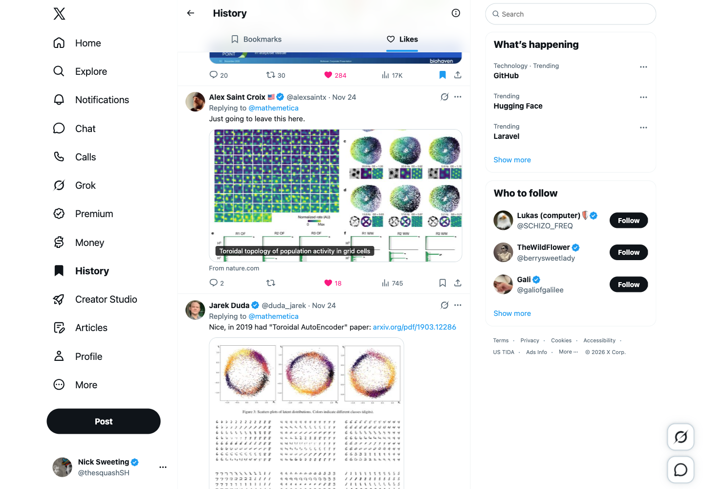
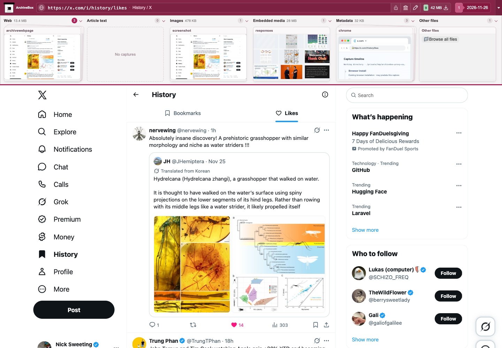
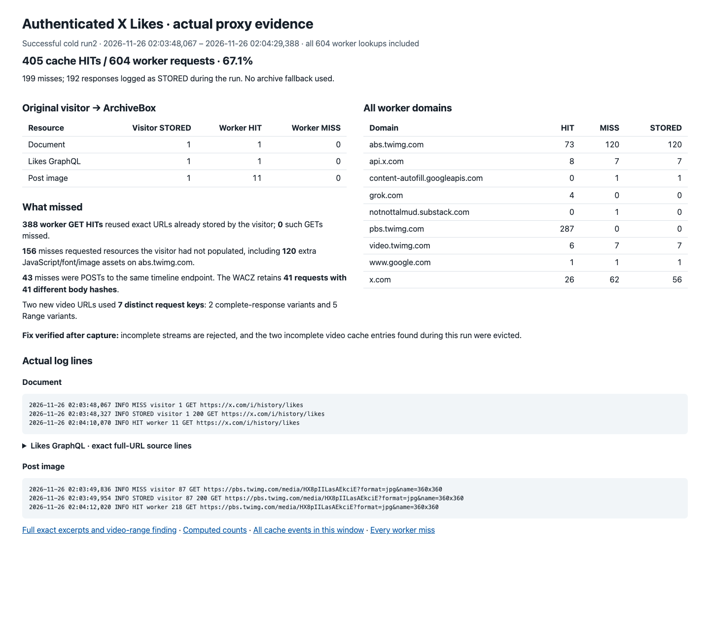

<div align="center">


# ArchiveBox Proxy

<p><strong>Browse once. Archive in the background. Replay from your collection.</strong></p>
<p>HTTPS caching · Automatic captures · HTTP/3 · Archive replay</p>
<p>
  <a href="#installation">Get started</a> ·
  <a href="#configuring-an-https-client">Connect a browser</a> ·
  <a href="#modes">Transports &amp; caching</a> ·
  <a href="#comments">Capture &amp; replay</a>
</p>

[](https://github.com/ArchiveBox/archivebox-proxy/actions/workflows/test.yml)
[](LICENSE)

</div>

<table>
<tr>
<th width="42%">① Your browser</th>
<th width="16%">② Proxelar</th>
<th width="42%">③ ArchiveBox</th>
</tr>
<tr>
<td valign="middle"><a href="docs/images/visitor-likes.png"></a></td>
<td align="center" valign="middle">
<strong>→ Cache</strong><br><br>
<strong>Hook →</strong><br><br>
<strong>← Capture requests</strong><br>
<sub>Reuse cache</sub>
</td>
<td valign="middle"><a href="docs/images/archivebox-likes.png"></a></td>
</tr>
<tr>
<td align="center"><sub>Browse and scroll to populate the cache.</sub></td>
<td align="center"><sub>Cache misses go upstream.</sub></td>
<td align="center"><sub>ArchiveBox runs its normal capture and saves the snapshot.</sub></td>
</tr>
</table>

<p align="center"><sub>The navigation hook runs <code>archivebox add --depth=0 URL</code>. ArchiveBox captures through the same cache and saves a snapshot ready to replay.</sub></p>

- 🌐 **Browse normally.** Your visits populate a shared HTTP/HTTPS response cache through [Proxelar](https://github.com/emanuele-em/proxelar).
- 📸 **Archive automatically.** Top-level navigations trigger normal [ArchiveBox](https://github.com/ArchiveBox/ArchiveBox) captures, with your plugins and authentication persona.
- ⚡ **Reuse what you already downloaded.** ArchiveBox reads through the same cache; additional resources go upstream through the same proxy.
- ⏪ **Replay from your collection.** Saved `responses/` files and `archivewebpage/*.wacz` can satisfy cache misses before another internet request.

The proxy owns its CA, response cache, and navigation queue. ArchiveBox owns its collection and creates snapshots through its usual capture pipeline. Archive fallback reads existing files; its derived index stays in the proxy data directory. Run a separate proxy and data directory for each user.

## Installation

```bash
git clone https://github.com/ArchiveBox/archivebox-proxy.git
cd archivebox-proxy
```

**Docker Compose** starts the proxy with a persistent, independent cache volume:

```bash
docker compose up --build -d
```

Wait up to ten seconds for the listeners, export the CA certificate, and [configure your browser](#configuring-an-https-client):

```bash
(
  set -eu
  proxy_container=$(docker compose ps --all -q proxy)
  test -n "$proxy_container"
  proxy_deadline=$((SECONDS + 10))
  while [ "$SECONDS" -lt "$proxy_deadline" ]; do
    if docker compose exec -T proxy test -s /cache/trust.pem 2>/dev/null; then
      docker compose cp proxy:/cache/ca/proxelar-ca.pem ./proxelar-ca.pem
      exit 0
    fi
    if [ "$(docker inspect --format '{{.State.Running}}' "$proxy_container")" != true ]; then
      docker compose logs --tail 50 proxy
      exit 1
    fi
    sleep 0.1
  done
  docker compose logs --tail 50 proxy
  echo 'Proxy did not become ready within ten seconds.' >&2
  exit 1
)
```

**Enable automatic ArchiveBox captures** by mounting an initialized collection:

```bash
export ARCHIVEBOX_DATA="$HOME/archivebox"
docker compose -f compose.yaml -f compose.capture.yaml up --build -d
```

This uses the official ArchiveBox image, including its browsers and capture tools. The normal ArchiveBox CLI writes the collection at `/data`; replay reads the same collection through `/archivebox`, and the proxy keeps its cache in `/cache`. Both processes share a container and UID, so the writable collection is accessible to both. The collection must be writable by ArchiveBox's UID/GID `911`. `ARCHIVEBOX_IMAGE` selects the image; the default is `archivebox/archivebox:0.9.78rc683`.

For **archive fallback without automatic captures**, mount the collection read-only:

```bash
export ARCHIVEBOX_DATA="$HOME/archivebox"
docker compose -f compose.yaml -f compose.archive.yaml up --build -d
```

<details>
<summary><strong>Run natively with uv and Rust</strong></summary>

Install [uv](https://docs.astral.sh/uv/) and [Rust through rustup](https://rustup.rs/). On Debian or Ubuntu, install the [native build dependencies](#debian) first.

```bash
uv sync --locked
uv run python bin/build_engine.py --locked --release
uv run archivebox-proxy \
  --engine ./target/release/archivebox-proxy-engine \
  --data "$HOME/.local/share/archivebox-proxy"
```

To enable captures, install ArchiveBox and initialize a collection:

```bash
uv tool install archivebox
mkdir -p "$HOME/archivebox"
(cd "$HOME/archivebox" && archivebox init)
```

Start the proxy with the collection selected:

```bash
uv run archivebox-proxy \
  --engine ./target/release/archivebox-proxy-engine \
  --data "$HOME/.local/share/archivebox-proxy" \
  --archivebox-dir "$HOME/archivebox" \
  --archive "$HOME/archivebox"
```

`--archivebox-dir` enables the normal `archivebox add --depth=0 URL` hook in that directory. `--archive` independently enables read-only fallback. Use `--archivebox-command '["uv","tool","run","archivebox"]'` to select a different CLI command prefix.

</details>

<details>
<summary><strong>Custom hooks and authenticated captures</strong></summary>

For a logged-in capture, use an ArchiveBox persona containing the browser session you visited with. This example selects the existing **Socials Only** persona used in the X demo. Run it from the proxy checkout after building the engine:

```bash
proxy_repo="$PWD"
(
  cd "$HOME/archivebox"
  uv run --project "$proxy_repo" archivebox-proxy \
    --engine "$proxy_repo/target/release/archivebox-proxy-engine" \
    --data "$HOME/.local/share/archivebox-proxy" \
    --archive "$PWD" \
    --hook '["archivebox","add","--depth=0","--persona","Socials Only","{url}"]'
)
```

The custom hook runs from the collection directory and inherits proxy and CA settings. `--hook` takes a JSON argument array, substitutes `{url}` literally, and can be repeated for multiple commands. To also send each URL to the system log, add `--hook '["logger","-t","archivebox-proxy","{url}"]'`. `PROXY_RECORD=true` enables navigation logging to `navigations.jsonl` and the configured hooks.

</details>

### Debian

```bash
sudo apt-get update
sudo apt-get install -y git clang cmake libclang-dev pkg-config openssl
```

For systemd, install the project at `/opt/archivebox-proxy`, copy the release engine to `/usr/local/bin/archivebox-proxy-engine`, and install [`archivebox-proxy.service`](archivebox-proxy.service). The unit stores its state in `/var/lib/archivebox-proxy` and runs under a dynamic service user. Listeners default to loopback; set `PROXY_BIND` in the service environment to enable remote access. Configure the service user and collection permissions when enabling an ArchiveBox CLI hook.

## Configuring an HTTPS Client

| Listener | Default address | Purpose |
| --- | --- | --- |
| Visitor | `127.0.0.1:8080` | Browser traffic populates the cache and triggers navigation hooks |
| Worker | `127.0.0.1:8082` | Capture tools reuse the cache without queuing another capture |

1. Set your browser's **HTTP and HTTPS proxy** to the visitor listener.
2. Import `DATA/ca/proxelar-ca.pem` as a trusted certificate authority, or use the certificate exported from Docker above.
3. Browse normally. Navigation hooks queue captures while the original visit fills the cache.

Share the CA certificate with clients; keep its private key in the proxy data directory. Hook processes receive the worker proxy URL and trust configuration automatically, including curl, requests, wget, Node, and ArchiveBox's Chromium arguments.

Use `--bind` to listen on another address and `--port` to change the visitor port. Docker publishes on loopback by default; set `PROXY_BIND` to expose the visitor listener to your network. Its worker port remains published on `127.0.0.1`. Certificate-pinned applications require their own trust configuration. For native deployments, `--worker-bind`, `--worker-port`, and `--worker-proxy` configure the address used by capture tools.

## Modes

`--mode` selects Proxelar's visitor transport. The worker listener remains an HTTP forward proxy.

| Mode | Configuration |
| --- | --- |
| `forward` | HTTP forward proxy with HTTPS interception; default |
| `socks5` | SOCKS5 with HTTP/HTTPS interception |
| `reverse` | `--target https://upstream-host`; native HTTP/3 capture and replay |
| `wireguard` | `--wireguard-endpoint host:port`; import `DATA/ca/proxelar-wg.conf` on the client |
| `dns` | DNS listener; upstream set with `--dns-upstream IP:port` |
| `udp` | UDP/QUIC forwarding to `--target IP:port` |

HTTP/3 is built into the engine and supported by the reverse proxy. The response cache replays completed HTTP exchanges. Proxelar forwards long-lived upgraded streams; DNS, WebSocket frames, and other native transport events are logged in `events.jsonl`.

**Control recording, caching, and archive replay independently:**

| Environment variable | Default | Controls | CLI override |
| --- | --- | --- | --- |
| `PROXY_RECORD` | `true` | Navigation logging, queuing, and capture hooks | `--record` / `--no-record` |
| `PROXY_CACHE` | `true` | Reading and writing the proxy's response cache | `--cache` / `--no-cache` |
| `PROXY_REPLAY` | `true` | Read-only fallback to the configured ArchiveBox collection | `--replay` / `--no-replay` |

CLI flags take precedence over environment variables. Disabled stages are omitted from the selected policy. `PROXY_RECORD` controls navigation hooks; `PROXY_POLICY` controls HTTP response lookup.

Native CLI options also take environment defaults named `PROXY_` plus the option name in uppercase, with underscores: for example, `--data` → `PROXY_DATA`, `--worker-bind` → `PROXY_WORKER_BIND`, and `--archivebox-command` → `PROXY_ARCHIVEBOX_COMMAND`. `ARCHIVEBOX_DATA` is an alias for `PROXY_ARCHIVEBOX_DIR`. `PROXY_HOOK` takes one JSON argument array; explicit `--hook` arguments replace that environment hook.

```bash
# Cache browsing traffic without triggering captures.
PROXY_RECORD=false docker compose up --build -d

# Capture normally while fetching through upstream instead of cache or archive.
PROXY_CACHE=false PROXY_REPLAY=false \
  docker compose -f compose.yaml -f compose.capture.yaml up --build -d

# Serve HTTP requests from an existing ArchiveBox collection only.
PROXY_RECORD=false PROXY_CACHE=false PROXY_REPLAY=true PROXY_POLICY=offline \
  docker compose -f compose.yaml -f compose.archive.yaml up --build -d
```

The collection examples use the `ARCHIVEBOX_DATA` path configured during installation. Compose also accepts `PROXY_MODE`, `PROXY_TARGET`, `PROXY_WIREGUARD_ENDPOINT`, `PROXY_DNS_UPSTREAM`, `PROXY_POLICY`, `PROXY_CACHE_GB`, `PROXY_BODY_LIMIT`, and a JSON argument array in `PROXY_HOOK`. Set a reachable `PROXY_WIREGUARD_ENDPOINT=host:port` for WireGuard; `WIREGUARD_ENDPOINT` remains an alias. Reverse and UDP modes use `PROXY_TARGET`.

**Choose how HTTP responses are served** with `--policy`:

| Policy | Lookup order |
| --- | --- |
| `auto` | Fresh cache → archive → upstream; default |
| `record` | Always upstream; replace matching cache entries |
| `replay` | Cache, including expired entries → archive → upstream |
| `offline` | Cache, including expired entries → archive → HTTP 504 on a miss |

`offline` applies to intercepted HTTP requests. DNS, raw UDP, and other forwarded protocols retain their normal transport behavior.

| Cache setting | Behavior |
| --- | --- |
| Freshness | At least **24 hours** from capture; longer origin freshness is retained. Hits do not extend expiry. |
| Responses | Completed responses, including POST results and HTTP errors. Request/response `no-store` does not prevent caching. |
| Matching | Method, exact URL, request body, Range, Accept-Encoding, and Content-Type. Other request headers, including cookies, do not partition this single-user cache. |
| Disk budget | **50 GiB** by default, with least-recently-used eviction; set `--cache-gb`. |
| Body limit | **64 MiB** per request/response body; set `--body-limit` in bytes. |

Bodies are content-addressed on disk with SQLite metadata. Truncated or incomplete exchanges are forwarded and logged, and only complete responses are eligible for replay. Conditional 304 responses preserve the existing response body.

## Comments

**A real authenticated capture:** the visitor scrolled four times through X Likes using the **Socials Only** persona. The navigation hook launched a normal ArchiveBox capture with the same persona, and the resulting WACZ loaded in replay.

| Observed during that capture | Result |
| --- | --- |
| Worker GETs for URLs already stored by the visitor | **388 hits, 0 misses** |
| Post images from `pbs.twimg.com` | **287 hits, 0 misses** |
| Page document and Likes API request | Each fetched once by the visitor, then served to ArchiveBox from cache |
| All worker requests | **405 / 604 hits (67.1%)** |

ArchiveBox also requested 156 resources the visitor had not populated and made 43 POST requests that missed the cache. POST matching includes the request body; the WACZ retained 41 requests to that endpoint with 41 distinct body hashes. These counts cover the whole capture, including new work performed by ArchiveBox.

<details>
<summary><strong>View the measured proxy logs and request breakdown</strong></summary>

[](docs/images/proxy-logs.png)

</details>

### Identifying User HTTP Requests - not trivial

Top-level navigations carry `Sec-Fetch-Mode: navigate` and `Sec-Fetch-Dest: document`. With recording enabled, they append to `navigations.jsonl` and enter a durable queue on the visitor listener. Hooks start after **ten seconds**, giving the original visit time to populate the cache. Successful captures are deduplicated by URL for **24 hours**; a later navigation requeues a failed hook. The worker listener suppresses navigation hooks to prevent recursive captures.

Hooks run sequentially as subprocesses. `hooks.jsonl` records starts, exit codes, and errors; `hooks.log` contains command output. Pending entries survive restarts. An interrupted hook remains recorded for inspection because its command may already have saved output.

Archive fallback indexes `responses/index.jsonl` and CDX/CDXJ entries inside `archivewebpage/*.wacz`. Its derived index lives in the proxy data directory and refreshes as captures change. WACZ replay reads the indexed WARC byte range and preserves response headers and encoded bodies; POSTs match the original paired request body. Loose `responses/` files support GET 200 replay from their recorded MIME type and decoded body. Missing, corrupt, or incompatible records fall through to the next source according to the selected policy.

<details>
<summary><strong>Build and verify the proxy</strong></summary>

The build helper downloads the pinned Proxelar revision into the dependency cache and applies the checked-in integration patch. It adds direct intercepted responses, interception backpressure, and the CA chain used by browser clients. Use the helper for engine builds and Clippy:

```bash
uv run python bin/build_engine.py --locked
uv run python bin/build_engine.py --locked --clippy
cargo fmt --check
uv run ruff check .
uv run pytest -v
```

Integration tests use real HTTPS and HTTP/3 origins, normal CLI subprocesses, persistent caches, and existing ArchiveBox capture fixtures.

</details>

### historic

2024-01: [Bruno Schroeder (@brunocek)](https://github.com/brunocek/archivebox-proxy) contributed the original mitmproxy navigation recorder.

2026-11: Rewritten around [Proxelar](https://github.com/emanuele-em/proxelar), an independent response cache, asynchronous navigation hooks, and read-only ArchiveBox replay.

[MIT](LICENSE). Proxelar retains its [MIT license](patches/Proxelar.LICENSE-MIT).
