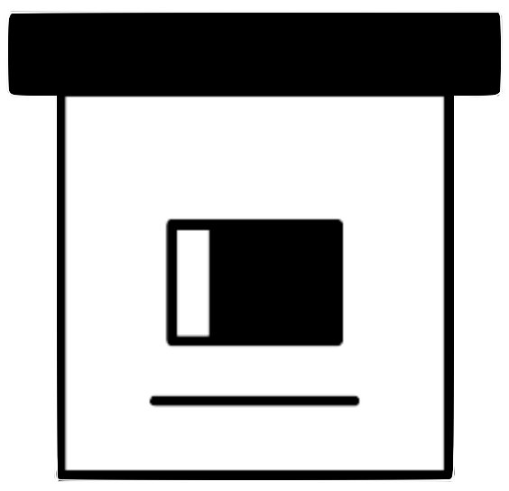
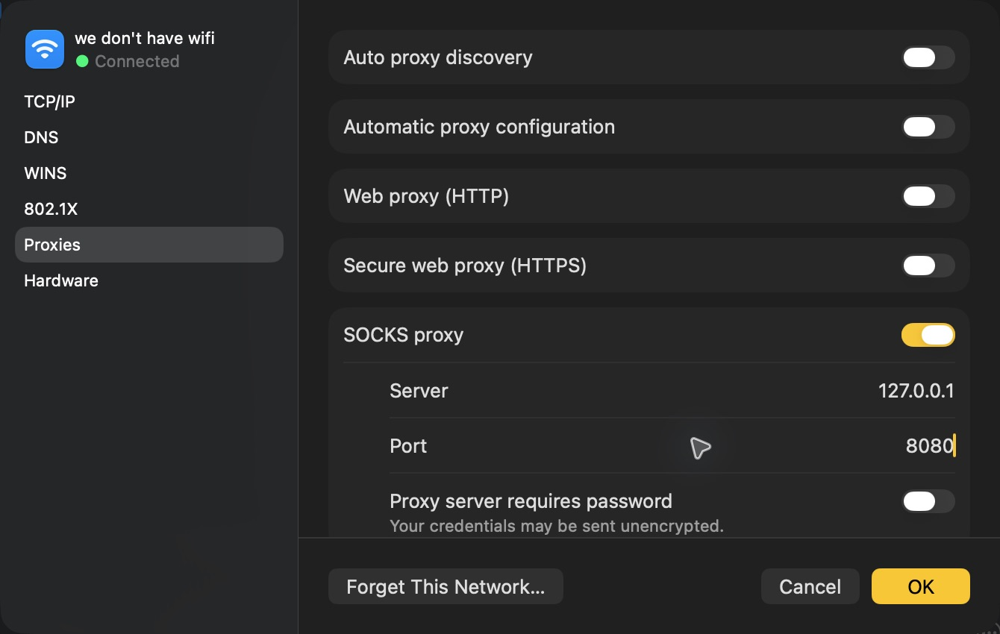

<div align="center">



# ArchiveBox Proxy

<p><strong>Browse once. Archive in the background. Replay from your collection.</strong></p>
<p>HTTPS caching · Automatic captures · HTTP/3 · Archive replay</p>
<p>
  <a href="#installation">Get started</a> ·
  <a href="#configuring-an-https-client">Connect a browser</a> ·
  <a href="#modes">CLI &amp; configuration</a>
</p>

[](https://github.com/ArchiveBox/archivebox-proxy/actions/workflows/test.yml)
[](https://github.com/ArchiveBox/archivebox-proxy/blob/master/LICENSE)

</div>

<table>
<tr>
<th width="42%">① Your browser</th>
<th width="16%">② Proxy</th>
<th width="42%">③ ArchiveBox</th>
</tr>
<tr>
<td valign="middle"><a href="https://raw.githubusercontent.com/ArchiveBox/archivebox-proxy/master/docs/images/visitor-likes.png"></a></td>
<td align="center" valign="middle">
<strong>→ Cache</strong><br><br>
<strong>Hook →</strong><br><br>
<strong>← Capture requests</strong><br>
<sub>Reuse cache</sub>
</td>
<td valign="middle"><a href="https://raw.githubusercontent.com/ArchiveBox/archivebox-proxy/master/docs/images/archivebox-likes.png"></a></td>
</tr>
<tr>
<td align="center"><sub>Browse and scroll to populate the cache.</sub></td>
<td align="center"><sub>Cache → archive → upstream</sub></td>
<td align="center"><sub>ArchiveBox runs its normal capture and saves the snapshot.</sub></td>
</tr>
</table>

<p align="center"><sub>Browse through the proxy. ArchiveBox saves your visits in the background and reuses what your browser already downloaded.</sub></p>

- 🌐 **Browse normally.** Your visits populate the HTTP/HTTPS response cache.
- 📸 **Archive automatically.** Top-level navigations trigger normal [ArchiveBox](https://github.com/ArchiveBox/ArchiveBox) captures, with your plugins and authentication persona.
- ⚡ **Reuse what you already downloaded.** ArchiveBox reads through the same cache; additional resources go upstream through the same proxy.
- ⏪ **Replay from your collection.** Browse saved content from your ArchiveBox collection when it is available.

## Installation

**Linux & macOS · ARM64 & AMD64 · Python 3.11+**

Install with [uv](https://docs.astral.sh/uv/getting-started/installation/), trust the certificate, and start:

```bash
uv tool install archivebox-proxy
archivebox-proxy --install-ca
archivebox-proxy --socks
```

Already using a Python environment? Install with `uv pip install archivebox-proxy` or `pip install archivebox-proxy` instead.

Look for **ArchiveBox Proxy is ready**, then [connect your browser](#configuring-an-https-client).

**Archive pages as you browse:** [install ArchiveBox and initialize a collection](https://github.com/ArchiveBox/ArchiveBox#quickstart), then select it:

```bash
archivebox-proxy --socks --archivebox ~/archivebox
```

For authenticated pages, add `--persona NAME` to use the same saved session as your browser. Captures reuse the proxy cache, and saved snapshots become available for replay.

<details>
<summary><strong>Docker Compose</strong></summary>

[Download this repository](https://github.com/ArchiveBox/archivebox-proxy/archive/refs/heads/master.zip) and run `docker compose up -d --build`. Look for **ArchiveBox Proxy is ready** in `docker compose logs`.

Export its certificate and trust it on your computer:

```bash
docker compose exec -T proxy archivebox-proxy --export-ca > proxelar-ca.pem
archivebox-proxy --install-ca proxelar-ca.pem
```

To include ArchiveBox, set `ARCHIVEBOX_DATA` to your initialized collection and use the [capture configuration](https://github.com/ArchiveBox/archivebox-proxy/blob/master/docker-compose.capture.yml). It uses **`archivebox/archivebox:dev`**. The [archive configuration](https://github.com/ArchiveBox/archivebox-proxy/blob/master/docker-compose.archive.yml) mounts an existing collection for replay.

</details>

## Configuring an HTTPS Client

On macOS, open **System Settings → Wi-Fi → Details → Proxies**. Enable **SOCKS proxy**, enter **127.0.0.1**, port **8080**, and click **OK**. Chrome uses these settings automatically.



Browse normally. With `--archivebox`, your visits also become ArchiveBox snapshots.

| Connect using | Setup |
| --- | --- |
| HTTP/HTTPS | Start with `--http`; set both browser proxy fields to `127.0.0.1:8080` |
| SOCKS5 | Start with `--socks`; use `127.0.0.1:8080` and enable proxy DNS in your browser |
| WireGuard | Start with `--wireguard`; import the generated configuration shown at startup into [WireGuard](https://www.wireguard.com/install/) |

For another device or a Wi-Fi hotspot, use this computer's LAN address, e.g. `--bind 192.168.1.189`. Export the certificate with `--export-ca proxelar-ca.pem` and trust it on the other computer with `archivebox-proxy --install-ca proxelar-ca.pem`. For WireGuard, also set `--wireguard-endpoint 192.168.1.189:8080`.

ArchiveBox's capture tools receive their proxy and certificate settings automatically.

## Modes

One command selects how clients connect:

| Command | Transport |
| --- | --- |
| `archivebox-proxy --http` | HTTP/HTTPS proxy; default |
| `archivebox-proxy --socks` | SOCKS5 |
| `archivebox-proxy --wireguard` | WireGuard tunnel |
| `archivebox-proxy --reverse --target https://news.ycombinator.com` | Reverse proxy |
| `archivebox-proxy --dns` | DNS proxy |
| `archivebox-proxy --udp --target 1.1.1.1:53` | UDP forwarding |

HTTP/3 capture and replay are available in reverse mode with an `http3://` target. WebSocket connections are supported.

**Turn recording, caching, and archive replay on or off:**

| Setting | CLI | Environment |
| --- | --- | --- |
| Automatically archive page visits | `--record` / `--no-record` | `PROXY_RECORD=true` / `false` |
| Proxy response cache | `--cache` / `--no-cache` | `PROXY_CACHE=true` / `false` |
| Replay from the ArchiveBox collection | `--replay` / `--no-replay` | `PROXY_REPLAY=true` / `false` |

All three are enabled by default. Select a collection with `--archivebox PATH` for capture and replay, or `--archive PATH` for replay only.

<details>
<summary><strong>Cache settings and advanced options</strong></summary>

| Option | Default |
| --- | --- |
| `--policy auto` | Fresh cache → ArchiveBox archive → upstream |
| `--policy record` | Upstream; replace matching cache entries |
| `--policy replay` | Cache, including expired entries → archive → upstream |
| `--policy offline` | Cache, including expired entries → archive → HTTP 504 on a miss |
| `--cache-gb 50` | 50 GiB disk budget, least-recently-used eviction |
| `--body-limit 67108864` | 64 MiB per request or response body |
| `--data PATH` | Your user's application data directory |
| `--port 8080` | Browser listener |
| `--worker-port 8082` | Capture listener |

Cached responses are reused for **at least 24 hours**. Sites can allow longer reuse. Use `--policy record` to fetch fresh responses, or `--no-cache` to turn caching off.

Options also accept `PROXY_` environment variables: `--data` → `PROXY_DATA`, `--port` → `PROXY_PORT`, and `--archivebox-dir` → `PROXY_ARCHIVEBOX_DIR`. CLI flags take precedence. Run `archivebox-proxy --help` for all options.

Use `--hook` to run your own command when you visit a page. See `archivebox-proxy --help` for its arguments.

</details>

[MIT](https://github.com/ArchiveBox/archivebox-proxy/blob/master/LICENSE). Powered by [Proxelar](https://github.com/emanuele-em/proxelar) and [ArchiveBox](https://github.com/ArchiveBox/ArchiveBox).
